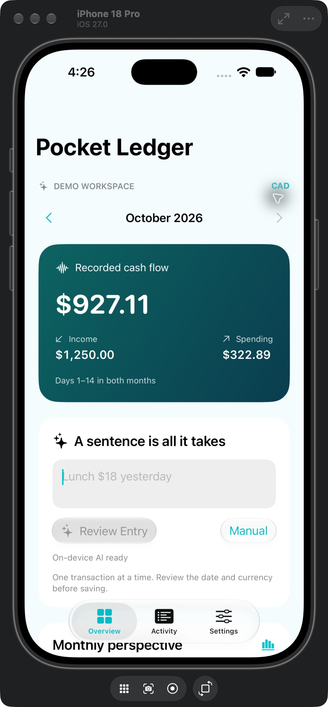
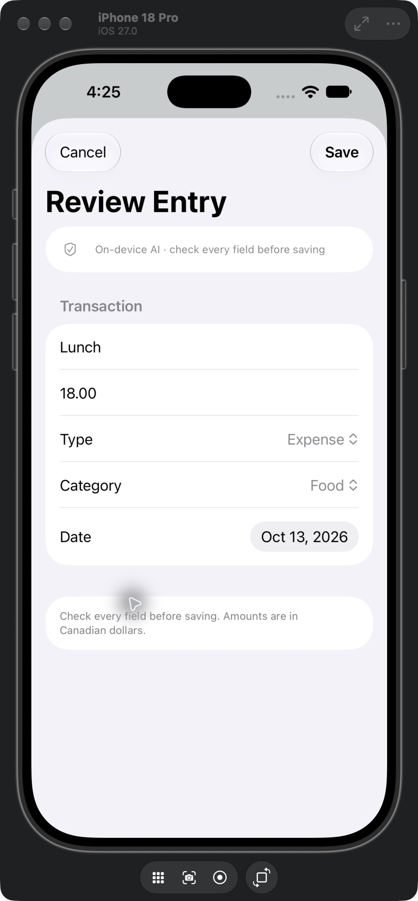

# Pocket Ledger

A local-first SwiftUI bookkeeping prototype for iPhone. Describe a transaction in a sentence, review the extracted fields, and compare recorded spending across months.

 

## Features

- English interface, native tab navigation, Liquid Glass buttons, and System / Light / Dark appearance.
- Natural-language entry through Apple Foundation Models with structured generation on supported devices.
- Clearly labeled basic parser when the on-device model is unavailable; manual entry always available.
- Editable review before saving: title, exact amount, income/expense, category, and date.
- Local JSON persistence with atomic writes; an unreadable existing file is preserved and protected from overwriting.
- Monthly spending chart, category breakdown, and like-for-like date ranges for the current month.
- AI explanations generated from calculated aggregates, not from invented transaction data.
- A separate fictional demo workspace; demo edits never overwrite personal transactions.

## Run

Open `PocketLedgerMobile.xcodeproj` in Xcode 27, select the PocketLedgerMobile scheme and an iPhone with iOS 27 (or simulator), then Run. No third-party packages or API keys are required. A Mac run destination is also available.

For a physical iPhone, select your own signing team in Signing & Capabilities. This repository does not include signing credentials.

The default workspace is Demo. To use persistent personal entries, turn off **Settings → Demo workspace**. Personal records persist even though the prototype reopens in Demo for presentations.

## 60-second demo

1. Show the Overview and the labeled fictional workspace.
2. Enter `Lunch 18 yesterday`, then choose Review Entry.
3. Check the title, CAD amount, category, and yesterday's date; save.
4. Open Activity and edit the new entry.
5. Return to Overview, scroll to Monthly perspective and Explain This Month when AI is available.
6. Switch Light / Dark in Settings.

## Design

| File | Responsibility |
| --- | --- |
| `Transaction.swift` | Identifiable, Codable transaction model; amounts in integer cents |
| `LedgerStore.swift` | Local persistence, demo isolation, exact amount parsing, monthly aggregates |
| `IntelligenceService.swift` | Model availability, structured extraction, basic parser, aggregate explanation |
| `ContentView.swift` | Overview, Activity, Settings and editable review sheet |
| `PrototypeChecks.swift` | Debug startup checks for cents, persistence, isolation, corrupt files and month boundaries |

The model interprets language. Swift code validates amounts, resolves today/yesterday and computes totals. The user approves every entry before storage. AI explanations remain model-generated and should be checked against the displayed figures.

## Scope and limitations

Prototype, not a bank-connected or production accounting app. CAD only. Quick Entry supports one transaction at a time and only today/yesterday dates; use the review date picker for other dates. The basic parser accepts one numeric amount and uses keyword categories. Full date extraction, currency conversion, recurring payments, sync and export are not implemented.

AI availability depends on Apple Intelligence eligibility, settings and model readiness. If unavailable, generated insights are disabled while deterministic charts and manual bookkeeping remain usable. No hosted model is used. Records are stored in the local app container without additional application-level encryption. Demo data is fictional and reset when the workspace is reloaded.

Current-month comparisons use days 1 through today's day number in both months, capped to the shorter month. Earlier months compare complete calendar months. Charts reflect recorded entries only, not completeness of someone's real finances.

## Author

Guanrui (Gary) Jiang · [GitHub](https://github.com/GaryJGR) · [LinkedIn](https://www.linkedin.com/in/guanrui-jiang-ab1393251/)
